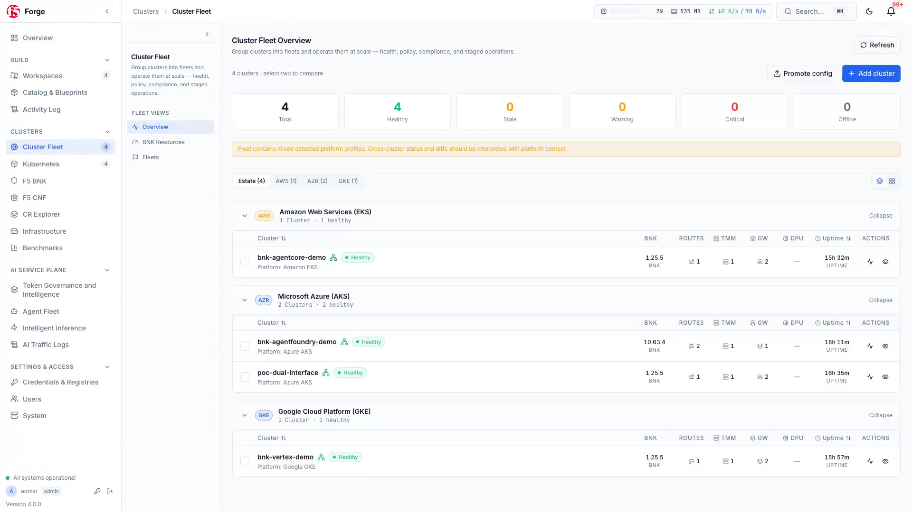
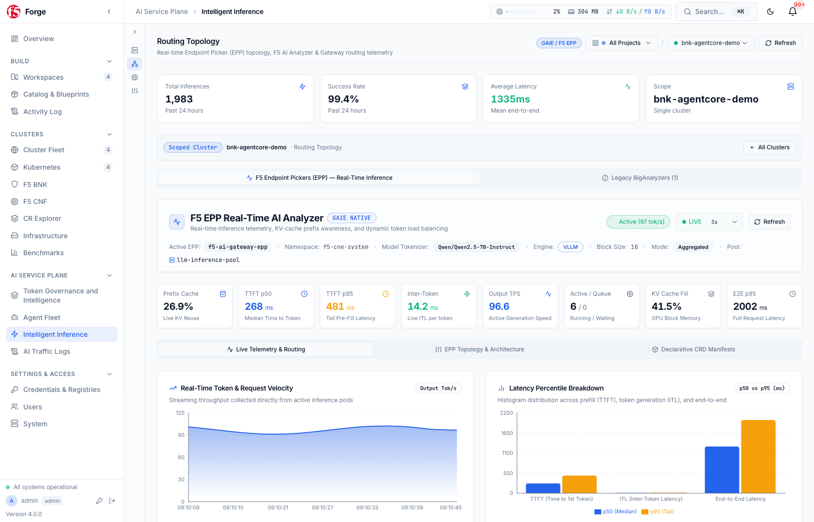

# `bnkctl` — Unified Multi-Cloud F5 BIG-IP Next for Kubernetes (BNK) Engine

[](go.mod)
[](LICENSE)
[](#supported-clouds--binaries)

`bnkctl` is a **pure-Go, multi-cloud lifecycle and validation CLI** for deploying, operating, upgrading, benchmarking, and tearing down **F5 BIG-IP Next for Kubernetes (BNK)** and **F5 AI Gateway** estates across **Amazon EKS**, **Azure AKS**, and **Google Cloud GKE** — with zero Terraform, zero shell-script glue, and native integration with **F5 BNK Forge**.


---

## Why `bnkctl`?

Deploying a production-grade Cloud-Native Network Function (CNF) and AI Gateway across three hyperscalers traditionally requires stitching together cloud-specific Terraform modules, Multus/CNI daemonsets, secondary NIC plumbing, BGP route servers, Helm charts, and post-install CRD reconciliations.

`bnkctl` replaces that complexity with **one declarative `cluster.yaml` intent file** and **one unified Go engine**:

- **One Engine, Four Binaries**: Produces the unified multi-cloud `bnkctl` binary (`--cloud aws|azure|gcp` or auto-detected from `cluster.yaml`) alongside cloud-pinned binaries (`awsbnkctl`, `azrbnkctl`, `gkebnkctl`) for drop-in backward compatibility.
- **Pure Cloud & Kubernetes SDKs**: Provisions VPCs/VNets, secondary data-plane subnets, multi-NIC worker pools, security groups, NAT gateways, and managed Kubernetes clusters directly via `aws-sdk-go-v2`, `azure-sdk-for-go`, `cloud.google.com/go`, `client-go`, and the Helm v3 Go SDK.
- **Version-Aware BNK Release Catalog**: Built-in support for BNK **2.3.x** (`legacy-spk`), **2.4.0**, **2.4.1**, and **2.5.0** (`gateway-infra`), including automatic release-quirk self-healing (`bnkctl heal`) and cross-train migration (`bnkctl migrate`).
- **Turnkey BNK Forge & AI Service Plane**: Automatically registers clusters with **F5 BNK Forge** during `bnkctl up`, seeds multi-cloud AI Token Governance and Smart LLM Routing across **AWS Bedrock**, **Azure AI Foundry**, and **Google Vertex AI**, and cleans up on `bnkctl down`.
- **Zero-Leak Teardown**: Deterministic reverse-dependency teardown (`bnkctl down`) strips stuck Kubernetes finalizers, removes cloud load balancers and secondary ENIs/NICs, deletes the cluster and network underlay, and unregisters from BNK Forge.

---

## Supported Clouds & Binaries

All four CLI binaries compile from this single repository and share `pkg/bnkengine`, `pkg/forge`, `pkg/intent`, `pkg/release`, and `pkg/scenarios`:

| Binary | Target Cloud | Default Underlay & Dataplane Architecture |
| :--- | :--- | :--- |
| **`bnkctl`** | **AWS, Azure, GCP** | Auto-detects cloud provider from `cluster.yaml` (`apiVersion` or `cloud.provider`) or `--cloud aws\|azure\|gcp`. |
| **`awsbnkctl`** | **AWS EKS** | VPC + Public/Private/DataPath Subnets (including AWS Local Zones), Multus + `host-device` / SR-IOV secondary ENIs, AWS Route Server BGP peering. |
| **`azrbnkctl`** | **Azure AKS** | VNet + System & TMM Node Pools, Accelerated Networking (`dual-interface`), dynamic secondary NIC attachment, VXLAN egress / L4 load balancing. |
| **`gkebnkctl`** | **GCP GKE** | Multi-VPC (`main`, `external`, `internal`) with Jumbo Frames (MTU 8896), GKE multi-network pod attachments (`virtio`), Cloud NAT & IAP jumphost. |

Build all four binaries with a single command:

```bash
make build
# Produces:
#   ./bin/bnkctl
#   ./bin/awsbnkctl
#   ./bin/azrbnkctl
#   ./bin/gkebnkctl
```

---

## What You Can Build with `bnkctl` + BNK Forge

When `forge.enabled: true` is set in your `cluster.yaml`, `bnkctl up` automatically bridges your cloud Kubernetes cluster into **BNK Forge** — giving you a visual control plane for CNF lifecycle, security policy authoring, multi-cloud AI token governance, and LLM benchmarking.

### 1. Unified Multi-Cloud Cluster Fleet & Blueprints Catalog

As soon as `bnkctl up` completes Phase 29 (Forge Registration), your AWS EKS, Azure AKS, and GCP GKE clusters appear in the **BNK Forge Cluster Fleet** with live TMM pod telemetry, Gateway API listeners, L4/L7 routes, and one-click deployable **Multi-Cloud Blueprints**.




### 2. Visual BNK Firewall, CGNAT, DNS & Security Policy Builder

Design and push F5 BNK firewall rules, AFM security policies, CGNAT pools, and Gateway API `HTTPRoute` / `L4Route` configurations visually, or reconcile them declaratively from `bnkctl`:


### 3. Multi-Cloud AI Token Governance & Data Guardrails

For BNK 2.4.1+ clusters with `bnk.aiGateway.enabled: true`, `bnkctl` provisions the F5 AI Gateway (`f5-ai-gateway`), Redis/DSSM state store, and OTEL token-telemetry collectors. BNK Forge provides real-time **Token Governance**, budget enforcement, PII/DLP guardrails, and prompt-injection protection across every cloud:


### 4. Smart LLM Router Fleet across AWS Bedrock, Azure AI Foundry & Google Vertex AI

Route agentic and inference traffic across primary and fallback foundation models in **AWS Bedrock** (Claude Sonnet / Haiku), **Azure AI Foundry** (GPT-4o / GPT-4.1), and **Google Vertex AI** (Gemini 2.5 Pro / Flash) — complete with Model Context Protocol (MCP) tool security and weighted failover:




### 5. Automated GenAI & Dataplane Benchmarking (`aiperf` + 15 Built-in Scenarios)

Compare throughput, Time-to-First-Token (TTFT), Inter-Token Latency (ITL), and token-rate enforcement across **F5 BNK + F5 GAIE**, Envoy AI Gateway, HAProxy, and `llm-d` Router, or run any of the 15 built-in Kubernetes validation scenarios (`bnkctl scenarios run`):


### 6. AI-Assisted Day-2 Operations via 153 MCP Server Tools

Every cluster registered by `bnkctl` can be inspected, diagnosed, and operated through BNK Forge's built-in **Model Context Protocol (MCP) Server**, exposing 153 structured tools for AI assistants and automation pipelines:


---

## Quickstart

### Prerequisites

1. **Go 1.26+** (to build from source)
2. **F5 BNK Credentials** (gitignored locally; never committed):
   - `license.jwt` — F5 BNK subscription JWT
   - `cne_pull_64.json` (or `dockerconfig.json`) — F5 Artifact Registry (`repo.f5.com`) pull secret
3. **Cloud Credentials** for your target cloud:
   - **AWS**: AWS CLI / SSO profile (`aws sts get-caller-identity`)
   - **Azure**: Azure CLI session (`az login`) or Service Principal env vars
   - **GCP**: Application Default Credentials (`gcloud auth application-default login`)

### 1. Build the CLI

```bash
git clone https://github.com/JLCode-tech/bnkctl.git
cd bnkctl
make build
```

### 2. Validate & Dry-Run Any Multi-Cloud Example Offline

You can validate any `cluster.yaml` and preview the full underlay + BNK overlay execution plan without touching live cloud APIs:

```bash
# AWS EKS + Bedrock AgentCore + BNK 2.4.1 AI Gateway
./bin/bnkctl validate -c examples/agentcore-demo/cluster.yaml
./bin/bnkctl up -c examples/agentcore-demo/cluster.yaml --dry-run

# Azure AKS + Azure AI Foundry + BNK 2.4.1 AI Gateway
./bin/bnkctl validate -c examples/agentfoundry-demo/cluster.yaml
./bin/bnkctl up -c examples/agentfoundry-demo/cluster.yaml --dry-run

# GCP GKE + Vertex AI Gemini + BNK 2.4.1 AI Gateway
./bin/bnkctl validate -c examples/vertex-agent-demo/cluster.yaml
./bin/bnkctl up -c examples/vertex-agent-demo/cluster.yaml --dry-run
```

### 3. Deploy End-to-End (`bnkctl up`)

```bash
# Deploy using the unified CLI (cloud auto-detected from cluster.yaml)
./bin/bnkctl up -c examples/agentcore-demo/cluster.yaml

# Or use the cloud-pinned binary directly
./bin/awsbnkctl up -c examples/agentcore-demo/cluster.yaml
./bin/azrbnkctl up -c examples/agentfoundry-demo/cluster.yaml
./bin/gkebnkctl up -c examples/vertex-agent-demo/cluster.yaml
```

### 4. Inspect, Heal, Benchmark & Teardown

```bash
# Check underlay, TMM dataplane, BNK release profile, and active quirks
./bin/bnkctl status -c examples/agentcore-demo/cluster.yaml

# Run BNK release-quirk self-healing and route pool resync
./bin/bnkctl heal -c examples/agentcore-demo/cluster.yaml
./bin/bnkctl bnk resync -c examples/agentcore-demo/cluster.yaml

# Verify F5 Forge registration & Multi-Cluster AI Governance readiness
./bin/bnkctl forge status -c examples/agentcore-demo/cluster.yaml
./bin/bnkctl forge governance overview -c examples/agentcore-demo/cluster.yaml

# Run validation scenarios (L4 TCP/UDP, gRPC, HTTP routing, Egress SNAT, AI Token Counting)
./bin/bnkctl scenarios list
./bin/bnkctl scenarios run http-routing-e2e -c examples/agentcore-demo/cluster.yaml

# Tear down all cloud & cluster resources cleanly with zero leaked ENIs/NICs/VPCs
./bin/bnkctl down -c examples/agentcore-demo/cluster.yaml
```

---

## Command Reference

| Command | Description |
| :--- | :--- |
| `bnkctl up` | Provision cloud underlay (VPC/VNet, subnets, cluster, secondary NICs) and deploy the BNK overlay stack + Forge registration |
| `bnkctl down` | Tear down BNK overlay, strip stuck finalizers, unregister from Forge, and destroy all cloud underlay resources |
| `bnkctl status` | Inspect cloud underlay state, BNK release train/profile, TMM dataplane readiness, and active release quirks |
| `bnkctl validate` | Validate `cluster.yaml` intent and dry-run render all BNK overlay manifests |
| `bnkctl doctor` | Verify local prerequisites, cloud credentials, FAR pull secret, and subscription JWT validity |
| `bnkctl heal` | Run idempotent BNK self-healing and version-specific quirk reconciliations |
| `bnkctl upgrade` | Upgrade BNK overlay in-place within the same architectural release train |
| `bnkctl migrate` | Migrate BNK overlay across architectural release boundaries (e.g., `2.3.x legacy-spk` -> `2.4.x/2.5.0 gateway-infra`) |
| `bnkctl bnk {status,scan,heal,resync,upgrade,migrate}` | Granular BNK overlay inspection, MCP endpoint scanning, and pool-member resynchronization |
| `bnkctl forge {register,unregister,status,governance}` | Register/unregister clusters with BNK Forge and manage Multi-Cluster AI Gateway governance |
| `bnkctl scenarios {list,show,run}` | List, inspect, and execute 15 built-in BNK L4/L7, egress, and GenAI validation scenarios |
| `bnkctl test {connectivity,dns}` | Execute TCP/UDP VIP connectivity and DNS probes from the cluster jumphost or probe pod |
| `bnkctl genai parse` | Parse `aiperf` benchmark artifacts into structured BNK Forge GenAI telemetry |
| `bnkctl k` | In-process Kubernetes `client-go` operations with automatic cluster template variable rendering |
| `bnkctl topology` | Render cluster network and TMM dataplane interface topology |

---

## Example Multi-Cloud Blueprints (`examples/`)

| Directory | Cloud | Architecture & Use Case |
| :--- | :--- | :--- |
| [`examples/agentcore-demo/`](examples/agentcore-demo/) | **AWS EKS** | Full BNK 2.4.1 AI Gateway + AWS Bedrock AgentCore + MCP Tool Security + AWS Route Server BGP |
| [`examples/agentfoundry-demo/`](examples/agentfoundry-demo/) | **Azure AKS** | Dual-Interface Accelerated Networking AKS + BNK 2.4.1 AI Gateway + Azure AI Foundry + MCP Token Shipper |
| [`examples/vertex-agent-demo/`](examples/vertex-agent-demo/) | **GCP GKE** | Multi-VPC Jumbo-Frame GKE + BNK 2.4.1 AI Gateway + Google Vertex AI (Gemini 2.5 Pro/Flash) + VXLAN Egress |
| [`examples/local-zone-boston/`](examples/local-zone-boston/) | **AWS Local Zone** | Low-latency Edge BNK deployment in `us-east-1-bos-1a` (`host-device` data path) |
| [`examples/local-zone-losangeles/`](examples/local-zone-losangeles/) | **AWS Local Zone** | Low-latency Edge BNK deployment in `us-west-2-lax-1a` |
| [`examples/local-zone-hamburg/`](examples/local-zone-hamburg/) | **AWS Local Zone** | Low-latency Edge BNK deployment in `eu-central-1-ham-1a` |
| [`examples/local-zone-warsaw/`](examples/local-zone-warsaw/) | **AWS Local Zone** | Low-latency Edge BNK deployment in `eu-central-1-waw-1a` |
| [`examples/local-zone-perth/`](examples/local-zone-perth/) | **AWS Local Zone** | Low-latency Edge BNK deployment in `ap-southeast-2-per-1a` |
| [`examples/local-zone-manila/`](examples/local-zone-manila/) | **AWS Local Zone** | Low-latency Edge BNK deployment in `ap-southeast-1-mnl-1a` |

---

## Documentation Index

- [**Architecture & Unified Engine Design (`docs/ARCHITECTURE.md`)**](docs/ARCHITECTURE.md) — How `bnkctl` unifies AWS EKS, Azure AKS, and GCP GKE behind a single `provider.Provider` interface and shared `pkg/bnkengine`.
- [**BNK Forge & AI Governance Integration (`docs/FORGE_INTEGRATION.md`)**](docs/FORGE_INTEGRATION.md) — Visual walkthrough of BNK Forge cluster registration, policy building, AI token governance, and Smart LLM Routing across AWS, Azure, and GCP.
- [**Multi-Cloud Quickstart Guide (`docs/MULTI_CLOUD_QUICKSTART.md`)**](docs/MULTI_CLOUD_QUICKSTART.md) — Step-by-step guide to deploying, validating, and tearing down BNK on AWS EKS, Azure AKS, and GCP GKE.

---

## License

Released under the [MIT License](LICENSE).
