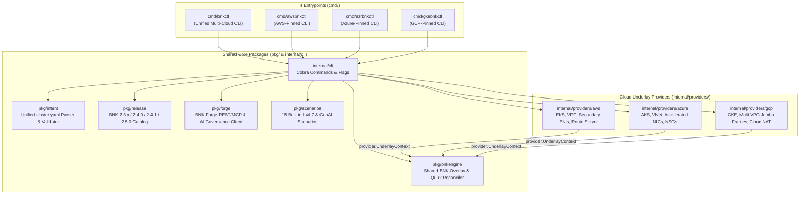

# `bnkctl` Architecture & Unified Multi-Cloud Engine

`bnkctl` consolidates three cloud-specific BNK lifecycle tools (`awsbnkctl`, `azrbnkctl`, and `gkebnkctl`) into a **single Go module (`github.com/JLCode-tech/bnkctl`)** with a shared BNK overlay engine, shared release catalog, shared validation scenario runner, and pluggable cloud underlay providers.

---

## 1. High-Level System Architecture



---

## 2. Repository Layout

```text
bnkctl/
├── cmd/
│   ├── bnkctl/          # Unified multi-cloud CLI entrypoint (--cloud aws|azure|gcp)
│   ├── awsbnkctl/       # AWS EKS-pinned CLI entrypoint
│   ├── azrbnkctl/       # Azure AKS-pinned CLI entrypoint
│   └── gkebnkctl/       # GCP GKE-pinned CLI entrypoint
├── internal/
│   ├── cli/             # Unified Cobra command tree (up, down, status, heal, migrate, forge, scenarios, ...)
│   └── providers/
│       ├── aws/         # AWS EKS underlay provisioning, secondary ENI attachment, S3/IAM/IRSA, Route Server
│       ├── azure/       # Azure AKS underlay provisioning, dual-interface Accelerated Networking, Workload Identity
│       └── gcp/         # GCP GKE multi-VPC underlay provisioning, multi-NIC node pools, IAP jumphost
├── pkg/
│   ├── bnk/             # Embedded BNK manifests, templates, and AI Gateway CRDs
│   ├── bnkconst/        # Canonical BNK namespaces, CRD group/version/resources, and constants
│   ├── bnkengine/       # Cloud-agnostic BNK overlay installer, upgrader, migrator, and quirk healer
│   ├── forge/           # F5 BNK Forge REST + MCP client, cluster registration, and AI Governance bootstrapper
│   ├── genai/           # aiperf benchmark parser and token-governance telemetry formatter
│   ├── intent/          # Unified cluster.yaml schema, defaults, and strict per-cloud validation
│   ├── jumphost/        # SSH and Kubernetes pod-exec probe runners for connectivity & DNS tests
│   ├── jwt/             # Offline F5 subscription JWT parser and expiration checker
│   ├── k8s/             # Dynamic client-go apply, wait, finalizer stripping, and template variable rendering
│   ├── netcalc/         # CIDR / SelfIP / VIP deterministic network calculator
│   ├── provider/        # Cloud-agnostic Provider interface and UnderlayContext contract
│   ├── release/         # Version-aware BNK release matrix (2.3.x, 2.4.0, 2.4.1, 2.5.0) and quirk registry
│   ├── scenarios/       # 15 end-to-end validation scenarios (HTTP, gRPC, TCP/UDP L4, Egress SNAT, AI Gateway)
│   └── state/           # Per-cluster state.env persistence (.bnkctl/, .awsbnkctl/, .azrbnkctl/, .gkebnkctl/)
├── examples/            # Ready-to-run multi-cloud blueprints (AWS AgentCore, Azure Foundry, GCP Vertex, Local Zones)
└── docs/                # Architecture, Forge Integration, and Multi-Cloud Quickstart guides
```

---

## 3. Cloud Underlay vs. BNK Overlay Separation

A core design principle of `bnkctl` is the strict boundary between **Cloud Underlay Provisioning** (`internal/providers/{aws,azure,gcp}`) and **BNK Overlay Orchestration** (`pkg/bnkengine`).

### The `provider.Provider` Contract (`pkg/provider/provider.go`)

Each cloud provider implements five methods:

1. `Name() string` — Returns `"aws"`, `"azure"`, or `"gcp"`.
2. `ValidateIntent(cl *intent.Cluster) error` — Validates cloud-specific `cluster.yaml` constraints.
3. `ProvisionUnderlay(ctx, cl, st, dryRun) (*UnderlayContext, error)` — Provisions VPC/VNet, subnets, NAT gateways, security groups/firewalls, managed Kubernetes cluster, multi-NIC TMM worker nodes, and optional jumphost.
4. `DiscoverUnderlay(ctx, cl, st) (*UnderlayContext, error)` — Hydrates an `UnderlayContext` from existing cloud resources and `state.env` without re-provisioning.
5. `DestroyUnderlay(ctx, cl, st, dryRun) error` — Tears down all cloud resources in reverse dependency order and cleans up `state.env`.

### The `UnderlayContext` Handoff

Once `ProvisionUnderlay` or `DiscoverUnderlay` finishes, it returns a normalized `provider.UnderlayContext` containing:
- Cluster name, region, Kubernetes `rest.Config`, and kubeconfig path
- Dataplane driver (`sock` / `host-device` / `virtio`) and CNI network attachment definitions (`external-nad`, `internal-nad`)
- TMM External and Internal `SelfIPs`, prefixes, VLANs/MTUs, and default `VIP` addresses
- Cloud-specific lifecycle hooks (`PreOverlayHooks`, `PostOverlayHooks`, `DiscoverDataplaneResources`)

`pkg/bnkengine.Engine` consumes only `UnderlayContext`, `intent.Cluster`, and `release.Profile`. As a result, **every BNK release train (`2.3.x`, `2.4.0`, `2.4.1`, `2.5.0`), self-healing quirk, and validation scenario works identically across AWS, Azure, and GCP**.

---

## 4. Version-Aware Release Catalog & Self-Healing Quirks (`pkg/release`)

BNK releases span two major architectural trains:

| Release Train | Versions | Architecture & Key Characteristics |
| :--- | :--- | :--- |
| **`legacy-spk` (2.3.x)** | `2.3.2-3.2598.3-0.0.464` | Uses `F5SPKVlan` CRDs and legacy CNE controller deployment names. |
| **`gateway-infra` (2.4.x / 2.5.0)** | `2.4.0`, `2.4.1`, `2.5.0` | Uses `BNKGatewayClassConfig`, `L4Route` / `HTTPRoute` Gateway API CRDs, FLO (`f5-lifecycle-operator`), and native **F5 AI Gateway** (`inference.k8s.f5.com/v1alpha1`) support. |

`pkg/release` tracks the exact FLO chart version, CNE image tags, Gateway API bundle version, and known release quirks for each version. Running `bnkctl heal` (or `bnkctl up`) automatically applies idempotent reconciliations for active quirks:
- **Webhook TLS & OTel Certificate Bootstrap**: Ensures `f5-cne-controller` conversion/validating webhooks and OTel collectors have valid certificates before CRDs are applied.
- **TMM DaemonSet Resource & Hugepages Tuning**: Adjusts TMM resource requests and hugepages for cloud VM shapes when needed.
- **AI Gateway Envoy Bootstrap & Redis/DSSM Wiring**: Reconciles BNK 2.4.1 AI Gateway configmaps, Envoy sidecar listeners, and token-rate enforcement stores.
- **Cross-Train Migration (`bnkctl migrate`)**: Safely transitions live clusters from `2.3.x` (`F5SPKVlan`) to `2.4.x/2.5.0` (`BNKGatewayClassConfig` + Gateway API) without recreating the cloud underlay.
