# F5 BNK Forge & F5 BNK AI Service Plane Integration

`bnkctl` includes native, first-class integration with [**F5 BNK Forge**](https://github.com/JLCode-tech/bnk-forge) (`pkg/forge`), transforming standalone Kubernetes clusters on AWS EKS, Azure AKS, and GCP GKE into a unified, visually managed multi-cloud CNF and **F5 BNK AI Service Plane**.

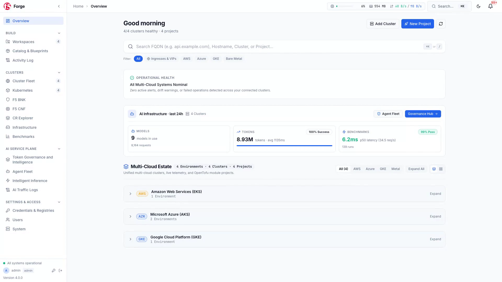

---

## 1. Automatic Lifecycle Linking (`bnkctl up` & `bnkctl down`)

Adding a `forge:` block to your `cluster.yaml` enables automatic zero-touch registration with [BNK Forge](https://github.com/JLCode-tech/bnk-forge) during `bnkctl up`:

```yaml
forge:
  enabled: true
  url: http://localhost:8000
  mcpUrl: http://localhost:8081/mcp/
  projectName: bnk-multi-cloud-demo
  credentialTemplateId: 1
  username: admin
```

### What Happens During `bnkctl up` (Phase 29) & `bnkctl forge register`
1. **Pre-Flight Cluster Reachability Ping**: `bnkctl` pings the Kubernetes API server (`/version`) before contacting Forge and warns immediately if the cluster is offline or DNS is unreachable.
2. **Kubeconfig Inlining & Container Loopback Rewriting**: Local `certificate-authority`, `client-certificate`, `client-key`, and `tokenFile` paths are flattened into embedded base64 `*-data` / `token` fields so OpenShift and On-Prem kubeconfigs work inside Forge containers. When Forge runs locally in Docker and the kubeconfig targets `127.0.0.1` or `localhost`, `bnkctl` automatically rewrites the endpoint to `host.docker.internal` while preserving TLS SNI (`tls-server-name`), or applies `--server-url`.
3. **Project, Platform & Credential Template Resolution**: `bnkctl` normalizes cloud and platform providers (`aws`, `azure`, `gcp`, `openshift`, `onprem`, `baremetal`, `kind`), creates or reuses the standardized `bnkctl-<workspace>` project, validates default or `--credential-template <id|name>` credentials (warning if secrets are missing), binds the template, and activates the project in Forge.
4. **Cluster Registration, Scan & Health Verification**: Uploads the flattened kubeconfig, writes `forge_link.json` in the workspace state directory, triggers an immediate cluster scan and BNK health check, and prints structured `Scan:` and `Health:` summaries (`bnk`, `api`, `flo`, `tmm`, `controller`, `overall`, `dataPlane`, `gateways`, `httpRoutes`).
5. **F5 BNK AI Service Plane & Governance Seeding**: When `bnk.aiGateway.enabled: true`, `bnkctl` automatically bootstraps the cluster's AI Governance organization, team, virtual API key (`f5vk_...`), and cloud LLM router pools in [BNK Forge](https://github.com/JLCode-tech/bnk-forge).

### What Happens During `bnkctl down`
- Before destroying the cloud underlay, `bnkctl down` automatically unregisters the cluster from [BNK Forge](https://github.com/JLCode-tech/bnk-forge) and removes stale cluster links so your Forge dashboard never accumulates orphaned clusters.

---

## 2. Multi-Cloud Cluster Fleet & Visual Policy Authoring

Once registered, all clusters across AWS, Azure, and GCP are visible in the **Multi-Cloud Cluster Fleet** view, displaying data-plane health, active listeners, BGP peering status, and throughput telemetry:

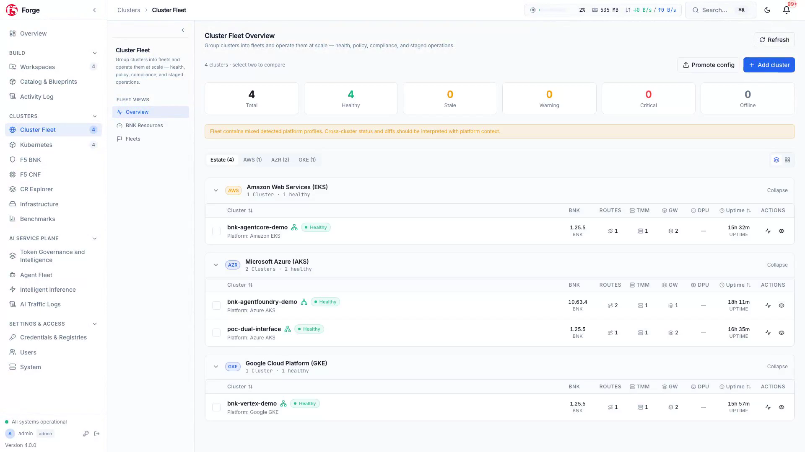

Operators can deploy pre-validated **Multi-Cloud Blueprints** or author L4/L7 traffic routing, NAT, and network security policies visually in the **BNK Policy Builder**. For complete documentation on F5 BIG-IP Next for Kubernetes traffic and security capabilities, see the [F5 BIG-IP Next for Kubernetes CloudDocs](https://clouddocs.f5.com/bigip-next-for-kubernetes/latest/overview.html):

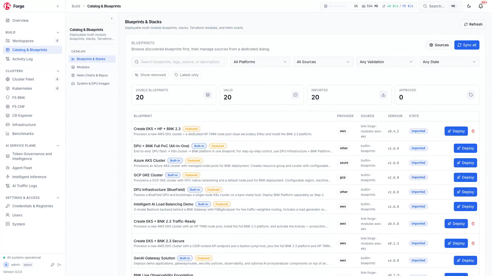

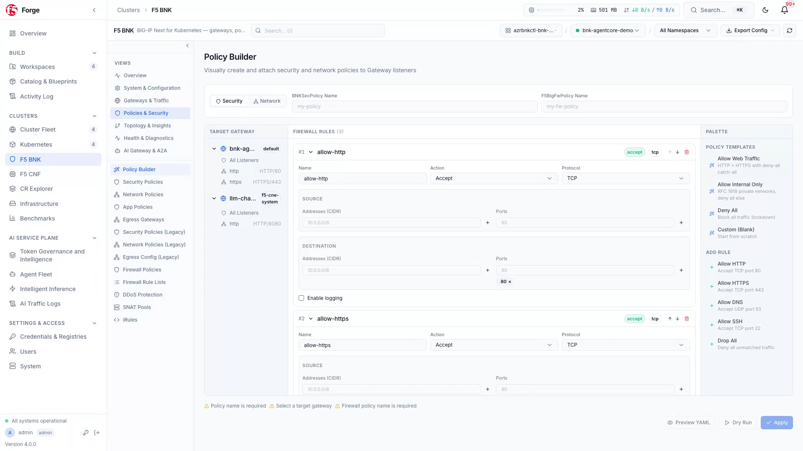

---

## 3. F5 BNK AI Service Plane: Token Governance & Guardrails

With BNK 2.4.1+, `bnkctl` enables the **F5 BNK AI Service Plane** to govern AI inference and agentic traffic across your clusters, while [BNK Forge](https://github.com/JLCode-tech/bnk-forge) aggregates token consumption, latency, cost, and guardrail enforcement across all three clouds in real time. See the [F5 BIG-IP Next for Kubernetes CloudDocs](https://clouddocs.f5.com/bigip-next-for-kubernetes/latest/overview.html) for full details on F5's cloud-native data plane capabilities:

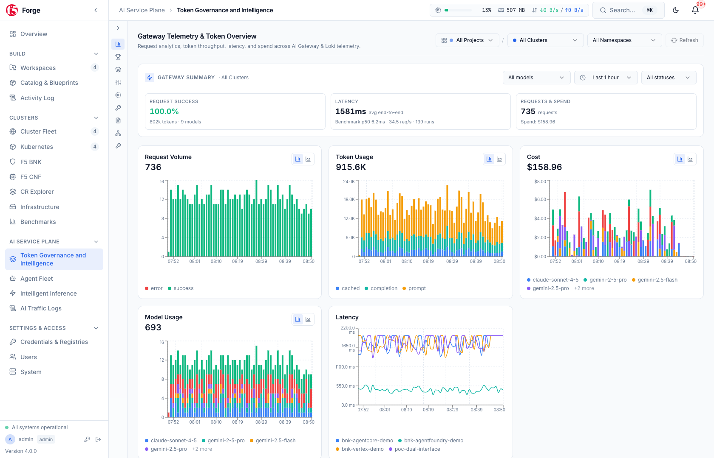

### Per-Cloud AI Governance Views

Each cloud cluster reports granular prompt/completion token usage, virtual key budgets, and model-level telemetry:

#### AWS EKS (`agentcore-demo` — Amazon Bedrock Claude Sonnet / Haiku)
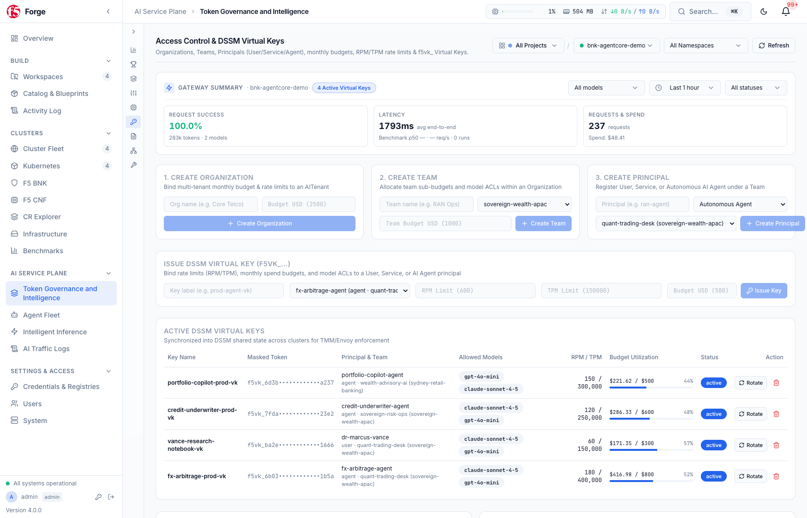

#### Azure AKS (`agentfoundry-demo` — Azure AI Foundry GPT-4o / GPT-4.1)
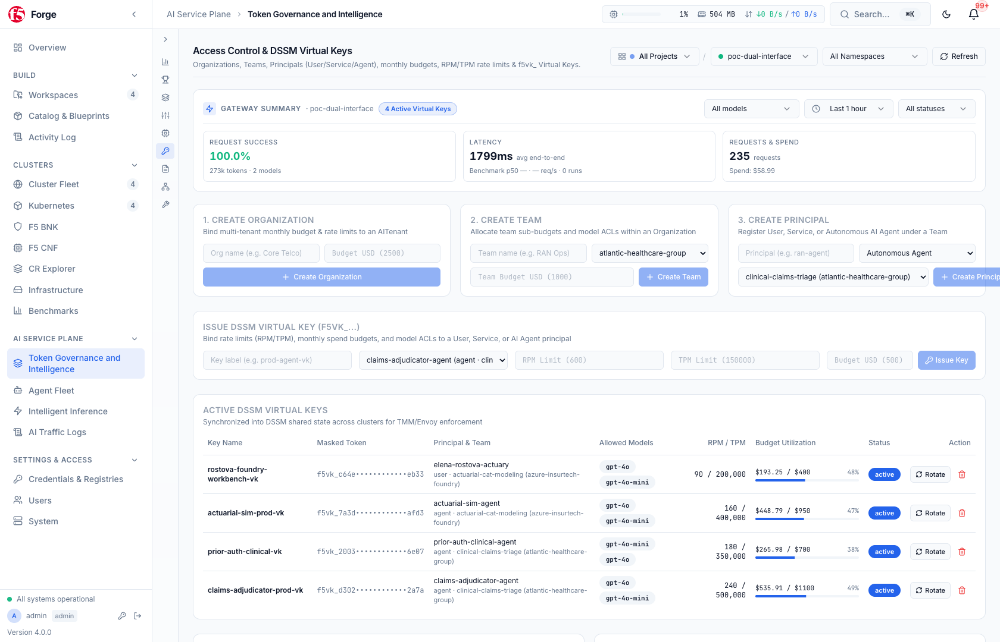

#### GCP GKE (`vertex-agent-demo` — Google Vertex AI Gemini 2.5 Pro / Flash)
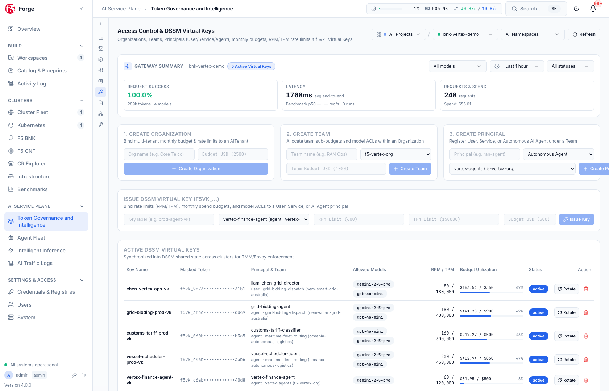

### AI Data Governance Guardrails (DLP, PII Redaction & Rate Limiting)

Enforce token-per-minute (TPM) rate limits, prompt-injection defense, and sensitive data redaction across every inference route:

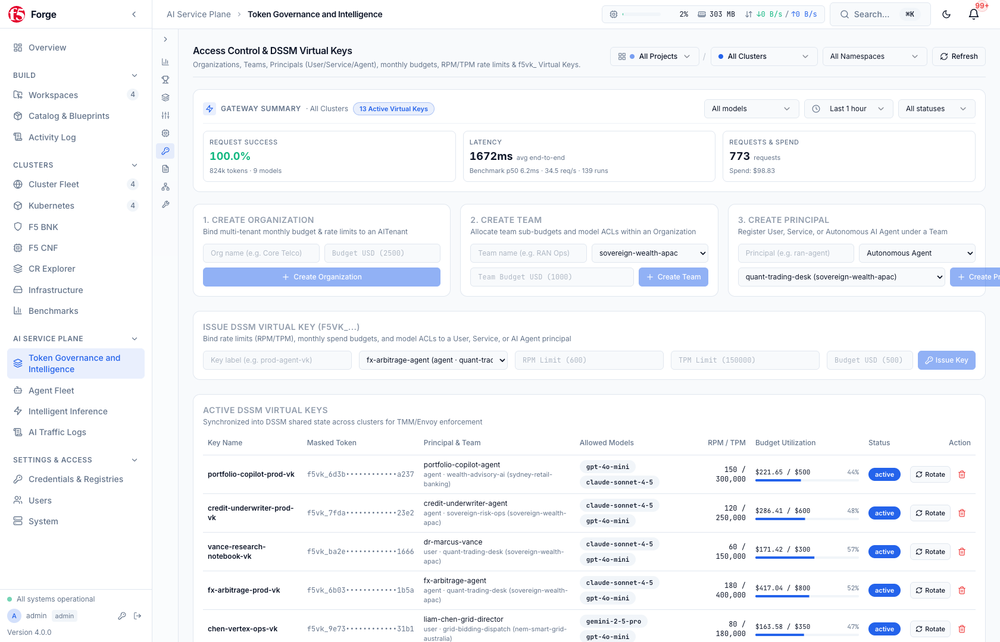

---

## 4. Smart LLM Router Fleet & Multi-Cloud Pool Topologies

`bnkctl` and [BNK Forge](https://github.com/JLCode-tech/bnk-forge) configure weighted primary/fallback LLM routing pools so agentic workloads automatically fail over across regions or model tiers when rate limits or provider errors occur:

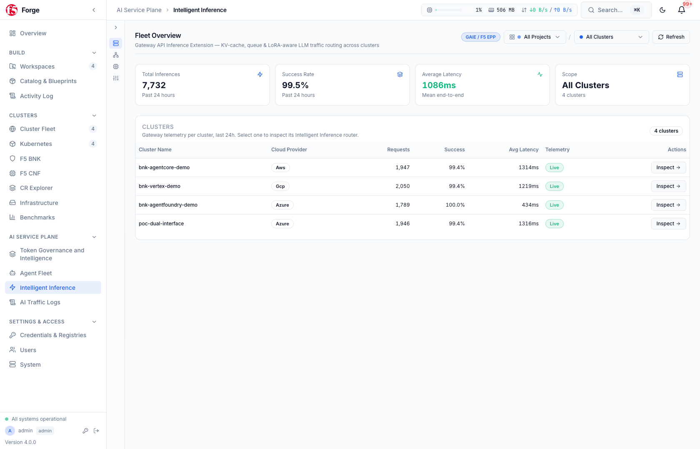

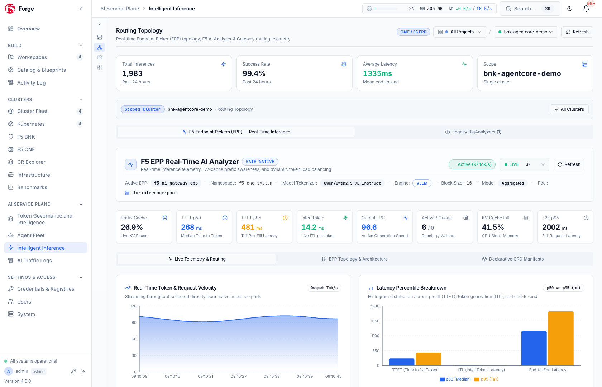

### Cloud-Specific LLM Router Pools

- **AWS Bedrock Pools (`ap-southeast-2` -> `us-east-1` fallback)**:
  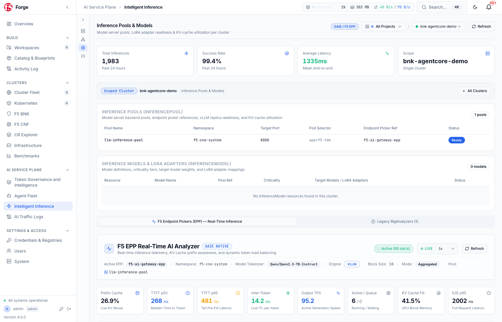
- **Azure AI Foundry Pools (`eastus2` -> `swedencentral` fallback)**:
  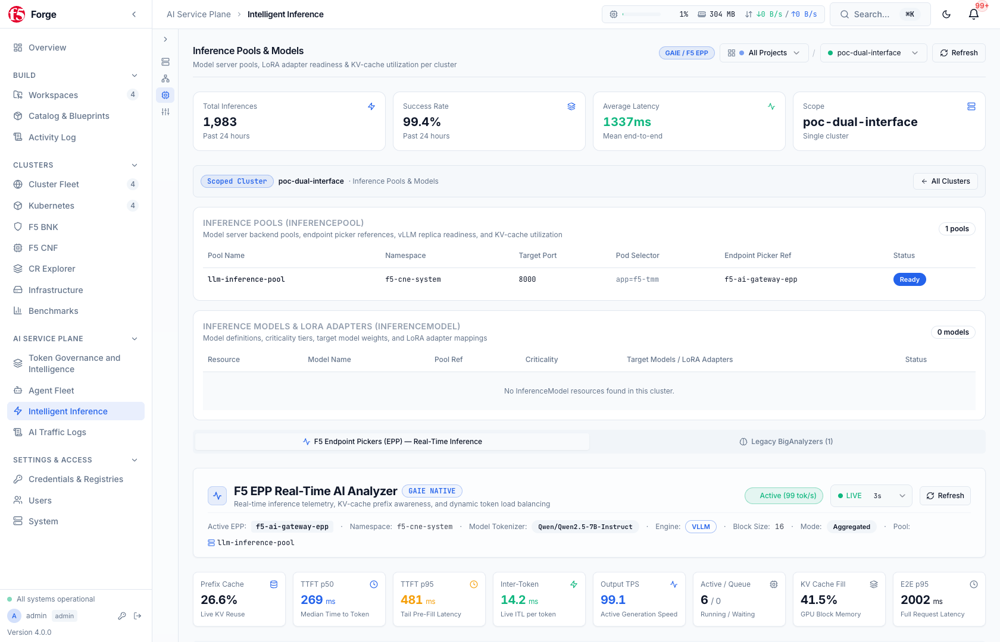
- **GCP Vertex AI Pools (`australia-southeast1` -> `us-central1` fallback)**:
  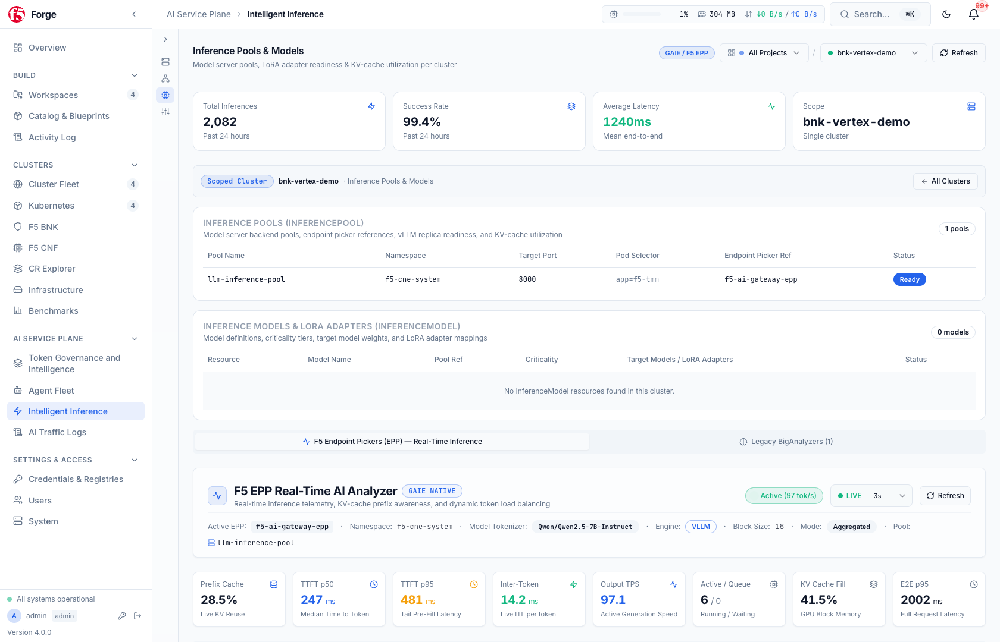

---

## 5. Multi-Stack GenAI Benchmarking & MCP Operations

Use `bnkctl genai parse` and [BNK Forge](https://github.com/JLCode-tech/bnk-forge)'s **Benchmark Dashboard** to compare F5 BNK + F5 GAIE against Envoy, HAProxy, and `llm-d` Router across concurrency tiers:

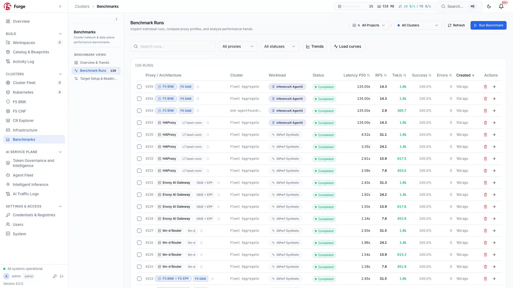

And connect any MCP-compatible AI coding or operations assistant to [BNK Forge](https://github.com/JLCode-tech/bnk-forge)'s **153 MCP Server Tools** for natural-language cluster inspection, policy verification, and live troubleshooting:

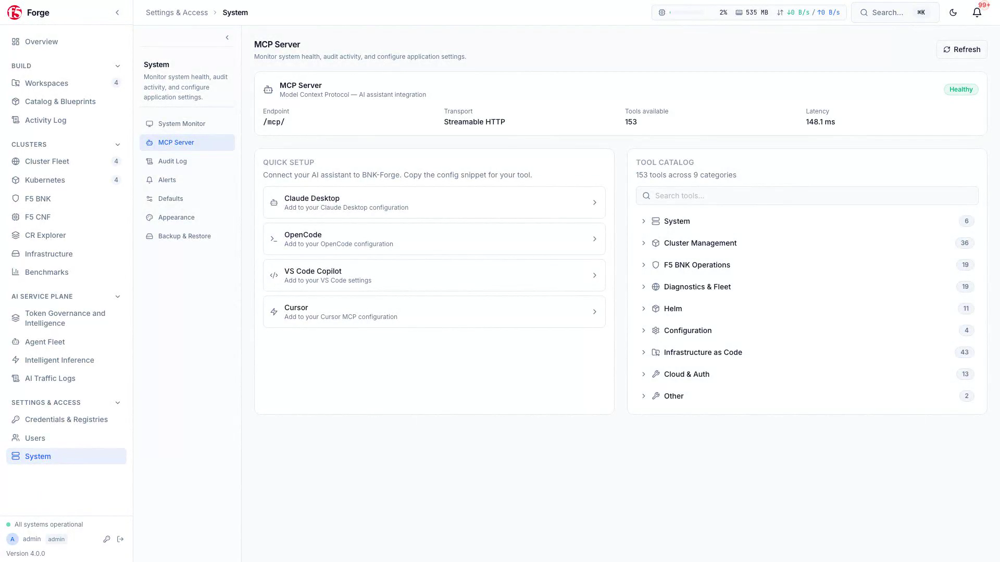

---

## 6. `bnkctl forge` CLI Commands

```bash
# Check Forge link status and server reachability (accepts cluster.yaml or workspace state dir)
bnkctl forge status -c cluster.yaml
bnkctl forge status -c .azrbnkctl/poc-dual-interface

# Register a cluster with BNK Forge (runs pre-flight ping, flattens kubeconfig, validates template, scans & checks health)
bnkctl forge register -c cluster.yaml
bnkctl forge register -c .azrbnkctl/poc-dual-interface

# Force re-upload of kubeconfig and re-trigger cluster scan & BNK health check (bypasses forge_link.json idempotency)
bnkctl forge register --rescan -c .azrbnkctl/poc-dual-interface
bnkctl forge register --force -c cluster.yaml

# Explicitly bind a Forge Credential Template by ID or name
bnkctl forge register --credential-template "Azure Local - ALM2" -c .azrbnkctl/poc-dual-interface
bnkctl forge register --credential-template 5 -c cluster.yaml

# Register an OpenShift, On-Prem, Bare-Metal, or Kind cluster with an explicit API server URL override
bnkctl forge register --cloud openshift --kubeconfig ~/.kube/ocp-config --server-url https://api.ocp.example.com:6443

# Inspect the Multi-Cluster F5 BNK AI Service Plane dependency graph & readiness checklist
bnkctl forge governance overview -c cluster.yaml

# Bootstrap F5 BNK AI Service Plane org, team, principal, and virtual API key (f5vk_...)
bnkctl forge governance bootstrap -c cluster.yaml

# Send a live chat-completion probe through the cluster's F5 BNK AI Service Plane VIP
bnkctl forge governance test-request -c cluster.yaml

# Remediate BNK 2.4.1 F5 BNK AI Service Plane configuration drift via Forge
bnkctl forge governance remediate -c cluster.yaml

# Unregister the cluster from BNK Forge (or --purge to also delete the parent Forge project)
bnkctl forge unregister -c cluster.yaml
bnkctl forge unregister --purge -c .azrbnkctl/poc-dual-interface
```
